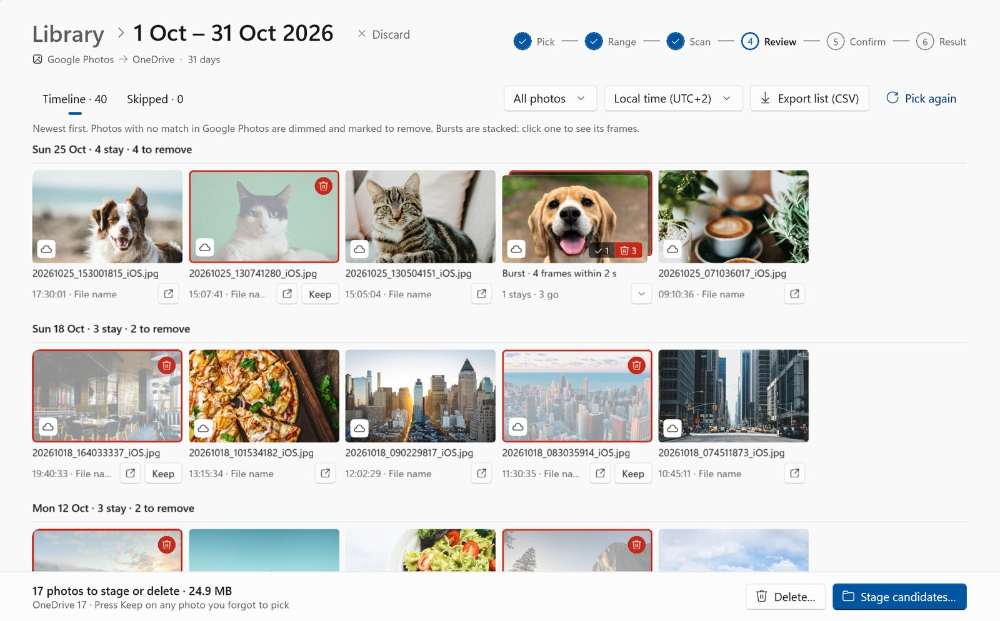
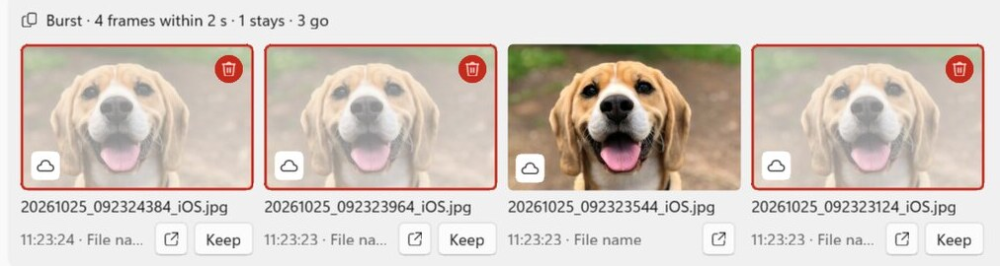
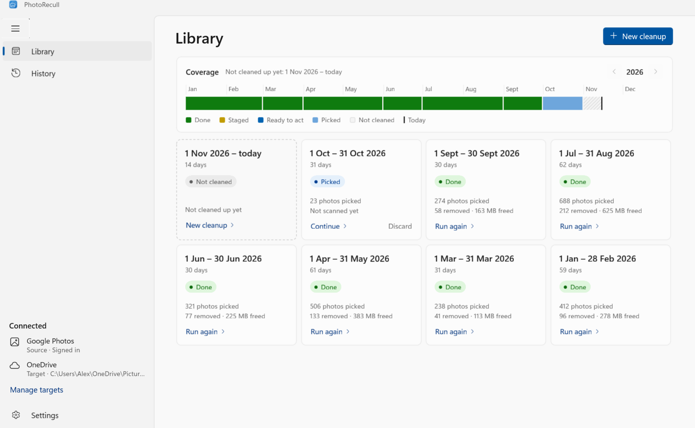

  
  <h1>PhotoRecull</h1>
  
Deleted it from Google Photos? Now it's gone from your other backups too.

  

    Your iPhone backs up to Google Photos <strong>and</strong> to OneDrive, a NAS or another
    folder. You tidy up in Google Photos, but every photo you deleted there stays in your
    other copies. PhotoRecull finds them and clears them out, so your backups match the
    library you actually kept.
  

  

    Coming soon to the Microsoft Store
    <a class="button" href="#how-it-works">How it works</a>
  

<figure class="screenshot">
  
  <figcaption>Every photo you deleted from Google Photos, dimmed and marked to remove, before anything happens.</figcaption>
</figure>

## Why not just do it by hand?

Because the same photo has a different name in every backup. Your iPhone and Google Photos
call it one thing; OneDrive renames it after the moment it was taken, in UTC, to the
millisecond; Synology Photos keeps the name but files it in a folder per month:

  
iPhone and Google Photos<code>IMG_4821.HEIC</code>

  
OneDrive<code>20261025_092323544_iOS.heic</code>

  
Synology Photos<code>2026\10\IMG_4821.HEIC</code>

So there's nothing to search for. Finding the copies of the photos you deleted means
comparing capture times, photo by photo, across hundreds of photos a month. A burst is a
dozen near-identical files, and a Live Photo is a photo and a video that must go together.
PhotoRecull reads each photo's capture time and matches it to Google Photos for you.

## Why PhotoRecull

  

    <h3>Your Google Photos cull, repeated</h3>
    
You pick the photos you kept in Google's own Photos Picker. Any copy in your other
    backups with no match is one you deleted, so it's marked to go.

  

  

    <h3>You review everything first</h3>
    
A timeline shows every photo, newest first, with the ones to remove dimmed. Spot one
    you forgot to pick? Press <strong>Keep</strong>.

  

  

    <h3>Safe by default</h3>
    
Stage first: candidates move to a review folder and nothing is deleted. Changed your
    mind? Move them back. Delete only when you're sure.

  

  

    <h3>Bursts and Live Photos understood</h3>
    
A burst is one stack: keep your favourite frame and the rest go. A Live Photo's video
    always goes with its photo.

  

  

    <h3>Any backup folder</h3>
    
OneDrive's Camera Roll, Synology Photos or another NAS, or any folder File Explorer
    can open, whichever app backs up to it. Add every one and clean them in one go.

  

  

    <h3>Private by design</h3>
    
PhotoRecull runs on your PC. It uses only the capture time of the photos you pick,
    never downloads them, and has no servers or analytics.

  

<figure class="screenshot">
  
  <figcaption>Bursts open up so you can see which frame you kept.</figcaption>
</figure>

## How it works

<ol class="steps">
  <li><strong>Pick.</strong> Choose a month and select the photos you still have in Google's
  Photos Picker, in your browser.</li>
  <li><strong>Scan.</strong> PhotoRecull reads the capture time of each iPhone photo in your
  backup folders: OneDrive, a NAS, or any other.</li>
  <li><strong>Review.</strong> Photos with no match were deleted from Google Photos. Check them
  in the timeline and keep anything you want.</li>
  <li><strong>Clean up.</strong> Stage them to a review folder, or delete them.</li>
</ol>

<figure class="screenshot">
  
  <figcaption>The Library shows which months are cleaned up, and how much space each cleanup freed.</figcaption>
</figure>

## Questions

**Does PhotoRecull change anything in Google Photos?**
No. It only has read access to the photos you select in the Photos Picker, and of those it
uses only the capture time.
See the [privacy policy](privacy.md).

**What do I need?**
Windows 10 or 11, and iPhone photos backed up to Google Photos and to at least one other
folder: OneDrive, a NAS such as Synology, or any folder File Explorer can open.

**Can I undo it?**
Yes, if you stage first: photos move to a review folder and nothing is deleted, so you can
move any back. In the Windows app, deleting from your PC sends photos to the Recycle Bin,
unless Windows can't recycle a file (say, it's bigger than the Recycle Bin), in which case
Windows asks before deleting it for good; the command-line version's `--delete` is always
permanent. Deleting from a NAS over the network skips the Windows Recycle Bin,
so turn on the NAS's own recycle bin for the shared folder first (on Synology: Control
Panel › Shared Folder › Edit; on QNAP: Network Recycle Bin). PhotoRecull warns you before
it deletes there, and looks for the recycle bin's folder, but a folder only shows it was
turned on once: check it still is.

**What about photos from other phones or cameras?**
By default PhotoRecull only touches iPhone photos: an iPhone saves the time zone with its
photos, so they match Google Photos exactly. You can turn that off for any folder to include
other phones and cameras. A photo saved without its time zone (some cameras, older iPhones)
stays whenever one of the photos you kept could be it, in any time zone, so a burst from
such a camera stays whole when you kept one frame. It's only removed when none of the
photos you kept could be it.

**Is it open source?**
Yes, under the MIT License. There's also a command-line version.
See [Open source](developers.md).

<footer class="site-links">
  <a href="privacy">Privacy policy</a> ·
  <a href="terms">Terms of service</a> ·
  <a href="developers">Open source</a> ·
  <a href="mailto:photorecull-support@googlegroups.com">Contact</a>
  
PhotoRecull is an independent project and isn't affiliated with or endorsed by Google,
  Microsoft, Synology or QNAP. Screenshots show demo photos from Unsplash.

</footer>
